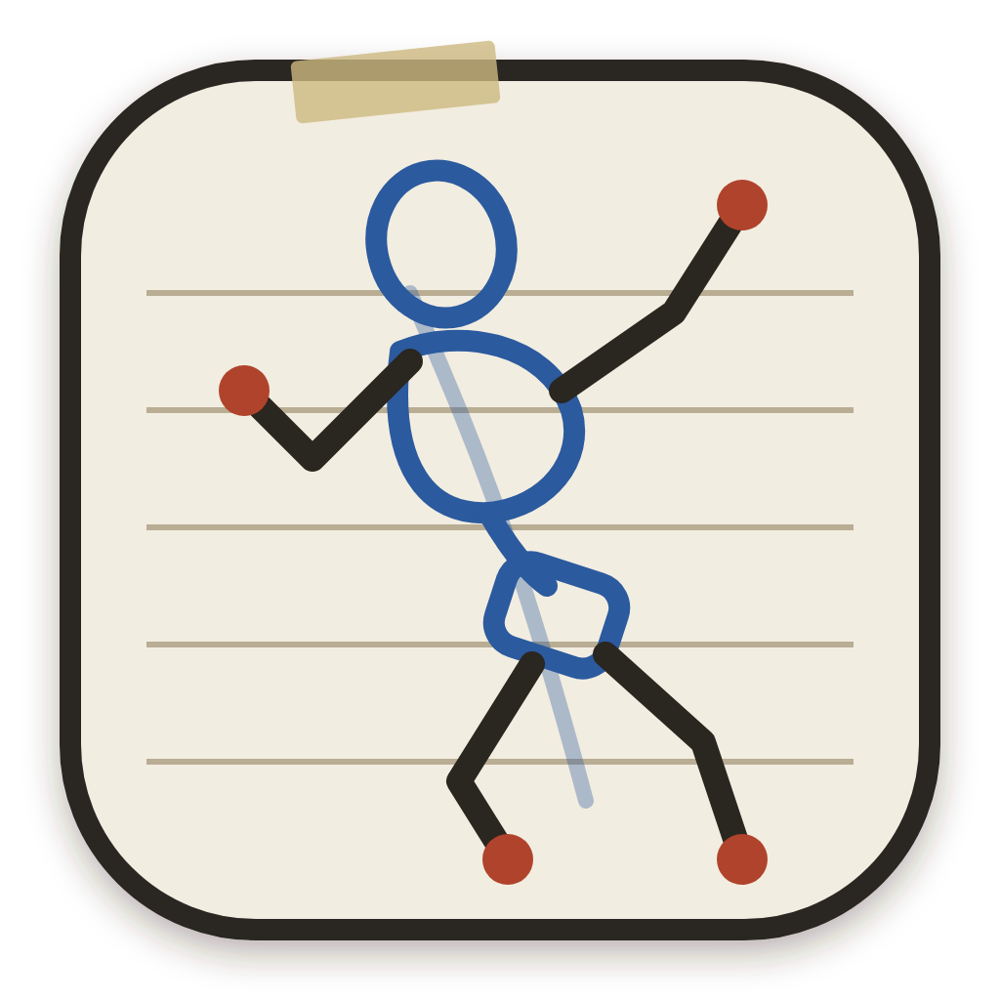

<p align="center"></p>

# NEOPOSE

Figura 3D para dibujar. Un maniquí de referencia con anatomía humana y anthro, poses, ropa, escenarios y luces, pensado para artistas.

- **Posado** en modo IK (arrastra manos, pies y pelvis), modo FK (arrastra cualquier articulación y solo gira su hueso) o girando cada articulación con el aro; clavar manos y pies, mezclar poses y sentarse en muebles; casi 100 poses individuales y más de 50 de grupo, poses al azar, gestos de manos y expresiones faciales. **Pose desde una foto**, sin conexión (BlazePose).
- **Cuerpo**: edad (de 11 a 90 años), género, musculatura, grasa, altura y estilización sobre la malla anatómica de MakeHuman; tipos de cuerpo de realista a chibi; 10 peinados con color; vista del esqueleto real (BodyParts3D).
- **Anthro**: lobo, zorro, perro, gato, conejo, cabra y dragón con cabezas esculpidas (realistas, toony y kemono), patas digitígradas o con pezuña, garras y cola.
- **Avatares importados**: VRM (VRoid, VRChat…), GLB o FBX humanoides propios, o la galería libre de [Open Source Avatars](https://opensourceavatars.com) (CC0/CC-BY). Se posan con los mismos controles.
- **Ropa**: 469 prendas de la comunidad MakeHuman organizadas por carpetas, que se adaptan al cuerpo y a la pose.
- **Escenarios**: 24 decorados (salón, taberna, castillo, teatro, calle, bosque, playa…) con modelos de Poly Haven y luces propias con sombra, y 8 panoramas de 360°.
- **Cámara**: objetivo, plano holandés, encuadres de 1, 2 y 3 puntos de fuga y vista de cuatro ventanas.
- **Todo tipo de cuerpos**: complexiones (delgada, fibrosa, atlética, culturista, fuerte, robusta, con curvas, pera, manzana, talla grande, embarazo, acondroplasia), ajustes avanzados de proporciones, músculo y grasa por zonas con formas corporales (targets de modelado de MakeHuman, CC0), y amputaciones a distintas alturas con muñón cerrado y prótesis posables (mano, mano biónica, gancho, pie, lámina de carrera); silla de ruedas, muletas y andador en la escena.
- **Músculos que reaccionan**: el bíceps se hincha y se acorta al doblar el codo, los gemelos se marcan de puntillas, el glúteo se tensa con la pierna atrás, el abdomen se pliega, el cuello marca el esternocleidomastoideo al girar la cabeza, y codos y rodillas mantienen el volumen. Formas generadas para cada cuerpo (más músculo, más se nota) que también sigue la ropa; control «Reacción muscular» en Proporciones. Skinning con cuaterniones duales: la muñeca girada no se estrangula.
- **Animación**: películas por planos (cada uno con su reparto, escenario y cámara animada), claves por personaje, papel cebolla y suavizado, y un guion de diálogo que mueve la boca (formas de Preston Blair) y sale en subtítulos. Galería de animaciones: 96 movimientos listos (andar, correr, saltar, luchar, gestos…, incluida la Universal Animation Library de Quaternius, CC0) para añadir a un plano o usar como pose; importa BVH, GLB o FBX animados (Mixamo, Rokoko, CMU…) o guarda tus pistas. **De dibujos a animación**: suelta una hoja de storyboard (se corta sola en viñetas), varias fotos o un vídeo y cada figura se convierte en pose clave, o el vídeo en captura de movimiento, con un clic. **Interpretación** con los principios de animación sobre cualquier movimiento (de la galería o interpolando poses): suavidad, anticipación, rebote, arrastre por articulaciones, arcos, estirar y encoger con volumen, exageración y ritmo a unos, doses o treses, con preajustes y trayectorias para ver el espaciado. Exporta fotogramas PNG en ZIP, fotogramas por capas, guion gráfico, vídeo MP4 o WebM, GIF animado y BVH.
- **Dibujo**: acabados de construcción, volumen, lápiz, valores y silueta; guías de tercios, fuga, regla de cabezas y línea de acción; capa de boceto con pinceles `.abr`; **dinamismo** para la imagen fija (línea de acción, equilibrio con el centro de masas, exagerar la pose, estirar y encoger, intercalados).
- **Para tu programa de dibujo**: PSD con capas (escenario, cada personaje, líneas, boceto y una capa vacía para dibujar) y botón **Abrir en…**, que en escritorio lo abre directamente en Krita, Clip Studio Paint, Photoshop, Affinity, GIMP…
- **Mis personajes**: guarda un personaje completo (cuerpo, proporciones, ropa, prótesis, avatar) con su retrato y vuelve a ponerlo en cualquier escena; se exporta e importa como archivo.
- **Movilidad**: poses y animaciones con muletas, bastón, andador y silla de ruedas, con la ayuda técnica siguiendo al personaje.
- **Del guion a la película**: escribe una escena como un guion (formato Fountain o simplemente «ANA: ¡Hola!» y frases como «Luis entra y se sienta») en cualquiera de los siete idiomas y NEOPOSE la anima sola, sin IA: reparto (tus personajes guardados si coinciden los nombres), escenario y hora del día (o un panorama buscado en línea), puesta en escena, más de 70 acciones con sinónimos y conjugaciones, poses de dos (abrazos, apretones de mano), expresiones, voces sintetizadas en el dispositivo (eSpeak NG) con los labios sincronizados palabra a palabra y subtítulos, y la cámara con reglas de cine: plano de situación, plano y contraplano sobre el hombro, regla de los 180°, sin saltos de eje ni de tamaño, seguimientos con aire delante. Las voces se exportan con el vídeo o como WAV.
- **Referencias libres**: busca fotos, obras de museo y GIF con licencia libre (Openverse, Wikimedia Commons) y panoramas y modelos CC0 (Poly Haven) sin salir de la app. Una foto se convierte en pose, un GIF en animación y un panorama o una foto en escenario, con la luz desde donde está el sol y objetos que encajan con la búsqueda. Filtro de contenido en capas (palabras, licencias, categorías curadas para los GIF y un clasificador en el dispositivo) y la autoría siempre a la vista.
- **Web app para iPhone y iPad**: la versión web ([pmirall.github.io/NEOPOSE/app](https://pmirall.github.io/NEOPOSE/app/)) se instala en la pantalla de inicio (Safari: Compartir → Añadir a pantalla de inicio), funciona sin conexión y guarda los archivos con la hoja de compartir.
- **Manejo directo**: arrastra una pose sobre un personaje (con vista previa antes de soltar), un gesto a una mano, un color a una prenda o al pelo, y objetos, luces o personajes guardados al punto del suelo donde los sueltes; las poses se deslizan hasta su sitio y cada cambio reversible ofrece «Deshacer». Ctrl+K (o la lupa) busca poses, ropa, escenarios y acciones; clic derecho o pulsación larga muestra lo que se puede hacer ahí; dos dedos deshacen y tres rehacen; en el móvil el panel es una hoja que se sube y se baja, con objetivos táctiles de 44 px.
- **Tutorial interactivo** de 2 minutos al abrirla por primera vez (y desde el botón de ayuda).
- **Práctica de gesto** con temporizador, con cuerpos aleatorios (con o sin anthro y chibis) y escenarios aleatorios si se quiere, y **exportación**: PNG (con fondo, transparente o solo trazo, hasta A3 a 300 ppp), hoja de giro, mapas para IA (profundidad, normales, OpenPose, líneas), GLB posado y BVH. Las escenas se comparten con un enlace que abre la versión web.
- **Idiomas**: inglés por defecto, español, y catalán, francés, portugués, alemán e italiano (traducción automática pendiente de revisión) (Ayuda → Language · Idioma). Cómo traducir: `docs/TRANSLATING.md`. Los textos están en `src/i18n/<idioma>.json`, con el texto en español como clave (`tools/i18n_sync.py` los mantiene al día).

## Descargas

**Linux (recomendado): repositorio Flatpak** en <https://pmirall.github.io/NEOPOSE/>. Un clic en «Instalar NEOPOSE» la abre en Bazaar, GNOME Software o Discover, y se actualiza con el resto de apps. Desde la terminal:

```sh
flatpak remote-add --user --if-not-exists flathub https://dl.flathub.org/repo/flathub.flatpakrepo
flatpak remote-add --user --if-not-exists neopose https://pmirall.github.io/NEOPOSE/neopose.flatpakrepo
flatpak install --user neopose io.github.pmirall.NEOPOSE
```

El repositorio se publica solo con cada tag (flujo «Flatpak repo») y está firmado con GPG.

### Archivos sueltos

En [Releases](https://github.com/pmirall/NEOPOSE/releases):

| Sistema | Archivo | Cómo instalar |
|---|---|---|
| Windows | `NEOPOSE-x.y.z-setup.exe` | Instalador. |
| Windows | `NEOPOSE-x.y.z-portable.exe` | Sin instalar: ejecútalo y listo. |
| Linux | `NEOPOSE-x.y.z-x86_64.flatpak` | `flatpak install --user NEOPOSE-x.y.z-x86_64.flatpak` (necesita el remoto Flathub para el runtime). |
| Linux | `NEOPOSE-x.y.z-linux-x86_64.AppImage` | `chmod +x` y ejecutar. |
| Android 7+ | `NEOPOSE-x.y.z-android.apk` | Ábrela en el móvil y permite instalar desde esa fuente. |

Los ejecutables no están firmados: Windows SmartScreen puede pedir «Más información → Ejecutar de todos modos».

## Desarrollo

Requisitos: Node 22 y Python 3.

```sh
npm install
npm start            # compila app/index.html y abre la app
npm run dist:linux   # Flatpak + AppImage en dist/ (necesita flatpak y flatpak-builder)
npm run dist:win     # instalador NSIS + portable en dist/
npx cap sync android && (cd android && ./gradlew assembleRelease)   # APK (necesita JDK 21 y el SDK de Android)
```

- `src/`: código de la app (módulos JS, HTML y CSS). `build.py` los une en `app/index.html`.
- `app/`: lo que se empaqueta: la página, three.js r147 y las fuentes (incluidos, funciona sin conexión), la figura, la ropa, las cabezas y los escenarios.
- `electron/main.js`: la ventana de escritorio. Sirve `app/` por un esquema privado `app://`.
- `android/`: proyecto Android de [Capacitor](https://capacitorjs.com). `npx cap sync android` copia `app/` dentro.
- `flatpak/`: manifiesto de Flathub (compila desde el código, sin conexión), ficha AppStream y entrada de escritorio.
- `fdroid/` y `fastlane/`: receta y fichas para F-Droid.
- `tools/`: los procesos que generaron los datos (malla y ropa de MakeHuman, cabezas esculpidas, escenarios de Poly Haven). Necesitan los recursos originales y no hacen falta para compilar la app.

## Publicar una versión

1. Sube la versión en `package.json`, `versionName`/`versionCode` en `android/app/build.gradle` y añade la versión a `flatpak/io.github.pmirall.NEOPOSE.metainfo.xml` y un `fastlane/metadata/android/*/changelogs/<versionCode>.txt`.
2. Si cambió `package-lock.json`: `flatpak-node-generator npm package-lock.json -o flatpak/generated-sources.json`.
3. `git tag v1.2.3 && git push origin v1.2.3`.
4. GitHub Actions compila Windows, Linux y Android y adjunta los archivos a un **borrador** de release. Revísalo y pulsa «Publish release».
5. Flathub y F-Droid detectan el tag nuevo (F-Droid lo hace solo; en Flathub se actualiza el manifiesto en su repositorio `flathub/io.github.pmirall.NEOPOSE`).

La APK de GitHub se firma con la clave guardada en los secretos del repositorio (`NEOPOSE_KEYSTORE_*`). F-Droid compila y firma la suya.

## Tiendas

- **Flathub** (y con ello Bazaar, GNOME Software y KDE Discover): el manifiesto está en `flatpak/`. El flujo «Flathub check» comprueba que compila y pasa el linter de Flathub.
- **F-Droid**: la receta está en `fdroid/` y las fichas en `fastlane/`.

## Licencia

El código de NEOPOSE es software libre bajo la [GNU GPL v3 o posterior](LICENSE): puedes usarlo, estudiarlo, modificarlo y redistribuirlo, siempre que las versiones derivadas sigan siendo libres con la misma licencia.

Los recursos de terceros (malla, ropa, escenarios, cabezas, fuentes y librerías) mantienen sus propias licencias libres: ver [CREDITS.md](CREDITS.md).
